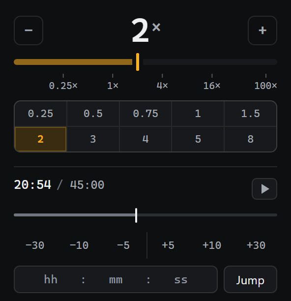
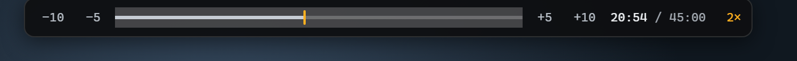

# Varispeed

A Chrome and Firefox extension that sets any HTML5 video from **1/16x to 100x**, and puts a seek bar on the video itself when you hold Shift.

Varispeed is the broadcast term for variable playback rate. That is the whole job: change how fast a video plays, and make it possible to jump around inside one without leaving the page.



## Why another speed extension

Most speed extensions stop at 4x, because Chrome clamps `video.playbackRate` to a 1/16 to 16 range. Two things follow from that clamp, and Varispeed handles both:

- **Below 1/16 there is no floor to fight.** Chrome's real minimum is `0.0625`, not the `0.25` most extensions expose. Varispeed opens the full range, so `0.0625x` is available for frame-by-frame study.
- **Above 16x the rate cannot go higher**, so Varispeed switches to fast seeking: it skips forward by `(speed - 16)` seconds of media per second of wall time. `100x` means a 2 hour video finishes in about 72 seconds.

The slider is log-scaled. On a linear `0.0625` to `100` track, everything from slow motion to 4x would be crushed into the first few percent, which is the range used most.



## Install

The same packages work on Linux, Windows, and macOS; no native app is required. On Linux, Chromium can also load the Chrome package through `chrome://extensions`.

### Chrome

Use the Chrome ZIP, not the Firefox ZIP:

1. Download `varispeed-chrome-1.6.0.zip` from the [latest release](https://github.com/kuy124/varispeed/releases/latest) (or build below) and unzip it.
2. Open `chrome://extensions`.
3. Turn on **Developer mode** (top right).
4. Choose **Load unpacked** and select the unzipped folder.
5. Pin Varispeed to the toolbar.

Targets current desktop Chrome (minimum Chrome 111 for `world: "MAIN"` content scripts).

To update an unpacked install, replace its files with the new ZIP contents, click **Reload** in `chrome://extensions`, and refresh video tabs.

### Firefox

Targets current desktop Firefox (minimum Firefox 140). The Firefox manifest includes an extension ID and declares that no data is collected.

1. Build below or download `varispeed-firefox-1.6.0.zip` and unzip it.
2. Open `about:debugging#/runtime/this-firefox`.
3. Choose **Load Temporary Add-on** and select the extracted `manifest.json`.
4. Open a video page and use Varispeed from the extensions toolbar.

Temporary add-ons are removed when Firefox restarts. Permanent installation in regular Firefox requires submitting the Firefox ZIP to Mozilla for signing (listed or unlisted); the generated ZIP is unsigned, not a permanently installable XPI. Firefox may ask you to grant website access through the extension's permissions.

### Build and verify

One shared source generates both browser packages. Python 3.9+ and Node.js 22+ are sufficient; no dependencies need installing.

```sh
python3 build.py
python3 test-build.py
node test.mjs
node test.mjs --firefox
node test-overlay.mjs
```

Outputs: `dist/chrome/`, `dist/firefox/`, `dist/varispeed-chrome-1.6.0.zip`, and `dist/varispeed-firefox-1.6.0.zip`. On Windows, use `python` instead of `python3` if needed. The last test requires installed Chrome or Chromium; Linux discovery checks `PATH`, `/usr/bin`, and `/snap/bin`. Set `CHROME_PATH` to override the executable, for example `CHROME_PATH=/usr/bin/chromium node test-overlay.mjs`. Headless tests do not need a desktop session. `--firefox` checks the Firefox API namespace with mocks, not a live Firefox browser.

## Use

**The panel** (toolbar icon) sets the rate:

- Drag the slider, or press `-` / `+` to step through the presets.
- Click a preset: `0.25 0.5 0.75 1 1.5 2 3 4 5 8`.
- The rate is saved and reapplied to every video opened afterwards, including videos in iframes.

**Seeking** works in two places, both of which act on the video that is actually on screen:

- **On the video:** hold Shift and point at a video for a full-width timeline with time previews (to a tenth of a second), buffered ranges, skip buttons, and a speed selector. Plain hover does nothing, so thumbnail previews and small embeds stay out of the way. The bar stays open while Shift is held, works in fullscreen and iframes, and lingers for two idle seconds after you release Shift over it. It stays visible while dragging or using the keyboard.
- **In the panel:** click the timeline to jump, drag to scrub, or type a time as `hh:mm:ss` and press Enter.

The panel talks to the page over messages rather than acting directly, because a popup runs in its own document and cannot reach a `<video>` in the tab. It picks the largest visible video on the page, so a small muted preview cannot take the seek instead of the main video.

## What it does not do

- **Per-site rates.** The rate is global.
- **Global keyboard shortcuts.** Player shortcuts are left alone. Arrow keys seek only when the overlay timeline is focused.
- **Auto-update for local builds.** Chrome unpacked and Firefox temporary installs do not update automatically.
- **Safari.** Only desktop Chrome and Firefox packages are provided.

## How it works

| File | Role |
|---|---|
| `manifest.json` | Manifest and content-script registration. |
| `main.js` | Runs in the page's own JS world. Calls `#movie_player.setPlaybackRate()` so YouTube's player keeps the rate instead of resetting it. |
| `content.js` | Isolated world. Finds videos, applies the rate, renders the on-video bar, handles seek messages from the panel. |
| `popup.html` / `popup.js` | The panel: rate slider, presets, transport, timecode jump. |

Two worlds are needed because a content script in the isolated world can set `video.playbackRate`, but YouTube's player owns that property and resets it on the next load. Only a script running in the page's world can call the player's own setter, so `main.js` relays the rate over `postMessage`.

## License

MIT. See [LICENSE](LICENSE).
