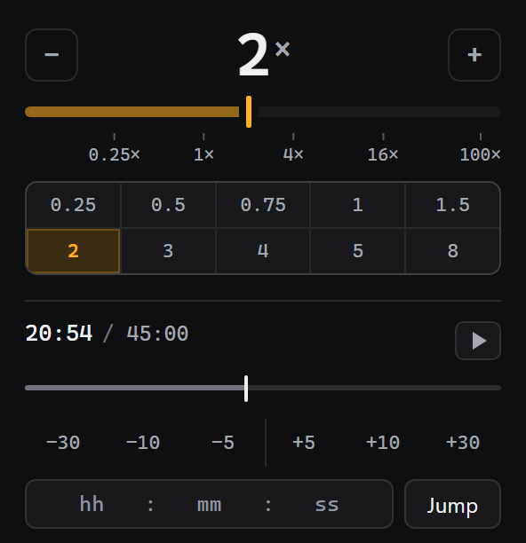

# Varispeed

A Chrome extension that sets any HTML5 video from **1/16x to 100x**, and puts seek controls on the video itself.

Varispeed is the broadcast term for variable playback rate. That is the whole job: change how fast a video plays, and make it possible to jump around inside one without leaving the page.

## Why another speed extension

Most speed extensions stop at 4x, because Chrome clamps `video.playbackRate` to a 1/16 to 16 range. Two things follow from that clamp, and Varispeed handles both:

- **Below 1/16 there is no floor to fight.** Chrome's real minimum is `0.0625`, not the `0.25` most extensions expose. Varispeed opens the full range, so `0.0625x` is available for frame-by-frame study.
- **Above 16x the rate cannot go higher**, so Varispeed switches to fast seeking: it skips forward by `(speed - 16)` seconds of media per second of wall time. `100x` means a 2 hour video finishes in about 72 seconds.

The slider is log-scaled. On a linear `0.0625` to `100` track, everything from slow motion to 4x would be crushed into the first few percent, which is the range used most.

## Install

Chrome does not distribute this in the Web Store, so it loads unpacked:

1. Download or clone this repo.
2. Open `chrome://extensions`.
3. Turn on **Developer mode** (top right).
4. Choose **Load unpacked** and select the repo folder.
5. Pin Varispeed to the toolbar.

Built and checked on Chrome 149. The manifest uses `world: "MAIN"` content scripts, so it needs a Chrome new enough to support them.

## Use

**The panel** (toolbar icon) sets the rate:

- Drag the slider, or press `-` / `+` to step through the presets.
- Click a preset: `0.25 0.5 0.75 1 1.5 2 3 4 5 8`.
- The rate is saved and reapplied to every video opened afterwards, including videos in iframes.

**Seeking** works in two places, both of which act on the video that is actually on screen:

- **On the video:** hover it for a bar with a draggable playhead, `-10 -5 +5 +10`, and a live `mm:ss / mm:ss` readout. Works in fullscreen and inside iframes. The bar hides again two seconds after the pointer stops, so it does not sit over the frame.
- **In the panel:** click the timeline to jump, drag to scrub, or type a time as `hh:mm:ss` and press Enter.

The panel talks to the page over messages rather than acting directly, because a popup runs in its own document and cannot reach a `<video>` in the tab. It picks the largest visible video on the page, so a small muted preview cannot take the seek instead of the main video.

## What it does not do

- **Per-site rates.** The rate is global.
- **Keyboard shortcuts.** The obvious candidates (arrow keys, `J`/`K`/`L`) are already bound by YouTube and most players, and overriding them breaks existing habits.
- **Auto-update.** Loading unpacked means Chrome does not update the extension.
- **Safari or Firefox.** `world: "MAIN"` content scripts are a Chrome MV3 feature.

## How it works

| File | Role |
|---|---|
| `manifest.json` | MV3 manifest, two content scripts, icons |
| `main.js` | Runs in the page's own JS world. Calls `#movie_player.setPlaybackRate()` so YouTube's player keeps the rate instead of resetting it. |
| `content.js` | Isolated world. Finds videos, applies the rate, renders the on-video bar, handles seek messages from the panel. |
| `popup.html` / `popup.js` | The panel: rate slider, presets, transport, timecode jump. |
| `gen_icons.py` | Generates `icon16/32/48/128.png` with Pillow. Run `python gen_icons.py` after changing the artwork. |

Two worlds are needed because a content script in the isolated world can set `video.playbackRate`, but YouTube's player owns that property and resets it on the next load. Only a script running in the page's world can call the player's own setter, so `main.js` relays the rate over `postMessage`.

## License

MIT. See [LICENSE](LICENSE).
