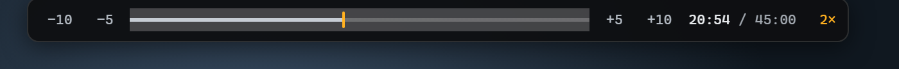

- Separate Chrome and Firefox packages, built from one shared source with the same speed controls and Shift-to-seek overlay.
- Firefox uses its native extension APIs and includes the required extension ID and no-data-collection declaration.
- Firefox now includes a native `.xpi` archive alongside the ZIP. Both contain identical files and support desktop Firefox 140+ on Linux, Windows, and macOS.
- Chrome loads unpacked as before. In Firefox, open `about:debugging#/runtime/this-firefox`, choose **Load Temporary Add-on**, and select the XPI. **The XPI and ZIP are unsigned**; temporary installs disappear after restart, and permanent installation in regular Firefox requires Mozilla signing. Firefox forks need compatible Manifest V3 APIs; older forks are not guaranteed to work.

[Download for Chrome](https://github.com/kuy124/varispeed/releases/download/v1.6.0/varispeed-chrome-1.6.0.zip). [Download Firefox XPI](https://github.com/kuy124/varispeed/releases/download/v1.6.0/varispeed-firefox-1.6.0.xpi). [Firefox ZIP alternative](https://github.com/kuy124/varispeed/releases/download/v1.6.0/varispeed-firefox-1.6.0.zip). [Installation and update instructions](https://github.com/kuy124/varispeed#install).
